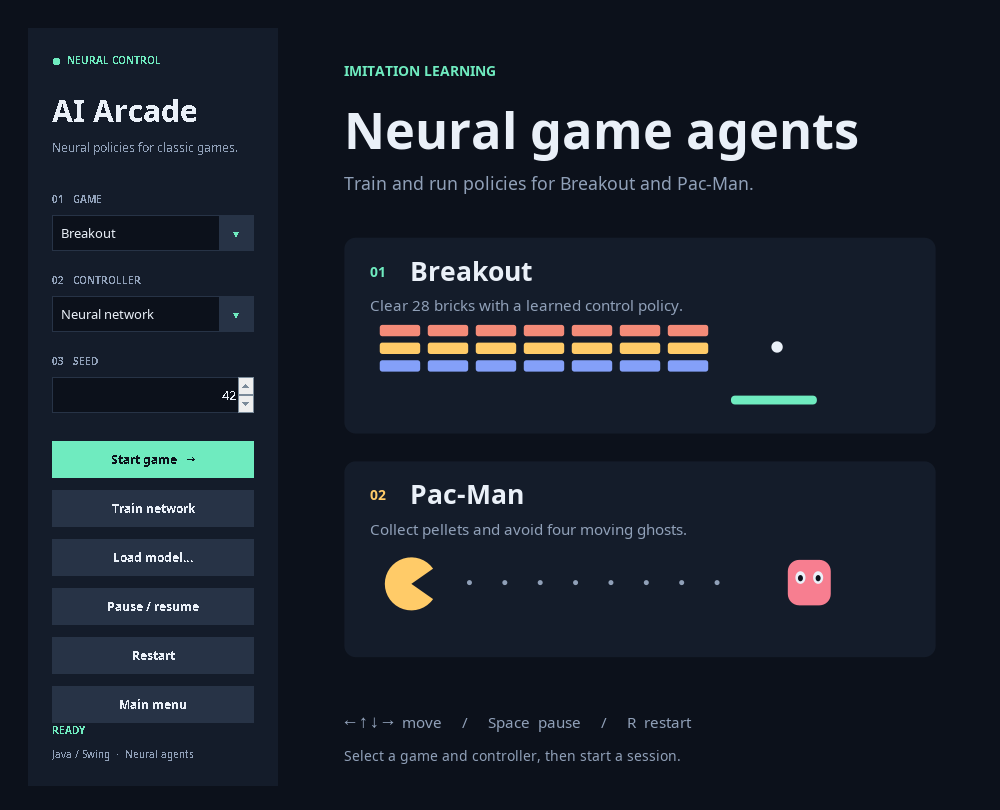

# AI Arcade

Neural controllers for Breakout and Pac-Man, implemented in Java 17 with Swing. Includes supervised training, pretrained models, deterministic simulation and controller benchmarks. No external runtime or ML dependencies.



## Run

Requires JDK 17+ with `java`, `javac` and `jar` on `PATH`, or `JAVA_HOME` set.

```bash
./run.sh
```

Windows PowerShell:

```powershell
./build.ps1
java -jar build/ia-arcade.jar
```

The Maven descriptor defines both source roots (`src` and `tests`) and the model resources for Java IDEs, including the Oracle Java extension in VS Code. With Maven installed, `mvn verify` runs the same headless regression suites and produces `build/maven/ia-arcade.jar`. The shell scripts require only the JDK.

The default controller is **Neural network**. Select a game, controller and seed, then click **Start game**. **Train network** runs training in a background worker and loads the resulting checkpoint. **Load model…** selects an existing `.nn` file.

| Input | Action |
| --- | --- |
| Arrow keys / WASD | Move in manual mode |
| Space / P | Pause or resume |
| R | Restart with the same seed |

Breakout has 28 bricks, three lives and 100 points per brick. Pac-Man has four ghosts, three lives and 10 points per pellet. Heuristic and random controllers are available as baselines.

## Neural policies

| Game | Architecture | Parameters | Observations |
| --- | --- | --- | --- |
| Breakout | 8 → 32 → 3 | 387 | Normalised positions, velocities and ball–paddle offset |
| Pac-Man | 24 → 32 → 4 | 932 | Open directions, food distances, ghost proximity and player position |

The MLP uses `tanh` hidden units and a `softmax` output. Backpropagation with Adam minimises cross-entropy against reference actions. Training starts with expert trajectories, then aggregates expert-labelled states visited by the learner across three rounds. The replay reservoir holds up to 24,000 samples.

This is **supervised imitation learning on engineered state features**. Pac-Man features include BFS distances to food and ghost proximity. Inference uses learned weights and masks actions blocked by walls; it does not call the expert controller. The models do not learn from pixels or rewards.

### Train

```bash
./run.sh --train --game breakout --episodes 16 --epochs 24 --seed 42 --model models/breakout-custom.nn
./run.sh --train --game pacman --episodes 32 --epochs 30 --seed 42 --model models/pacman-custom.nn
```

`--episodes` sets episodes per round; `--epochs` sets total epochs; `--steps` limits each episode. Training writes:

| Output | Contents |
| --- | --- |
| `.nn` | Game, feature version, architecture and learned weights |
| `.nn.training.csv` | Training loss, validation loss and expert-action accuracy per epoch |
| `.nn.benchmark.csv` | Neural, heuristic and random controller results |
| `.nn.report.txt` | Configuration, seeds and checkpoint-selection results |

Checkpoint selection uses mean score on eight validation seeds. Final evaluation uses 20 separate test seeds. Expert-action accuracy measures imitation; game score and wins measure policy performance.

Load a new checkpoint without rebuilding:

```bash
java -jar build/ia-arcade.jar --game pacman --controller neural --model models/pacman-custom.nn
```

Pretrained models are bundled in the JAR. `--model` overrides the bundled checkpoint. Training a file on disk does not replace a model already packaged in an existing JAR.

### Recorded benchmark

20 test seeds (`1000042..1000061`), 20,000-step limit per episode:

| Game | Random · mean score / wins | Heuristic · mean score / wins | Neural · mean score / wins |
| --- | --- | --- | --- |
| Breakout | 520 / 0 of 20 | 2800 / 20 of 20 | **2800 / 20 of 20** |
| Pac-Man | 884 / 0 of 20 | 1790 / 20 of 20 | **1790 / 20 of 20** |

These results cover the included levels. Breakout has limited seed variability, mainly its initial ball direction. Raw training logs and reports are in [models/metrics/](models/metrics/). The bundled models use seed 42: Breakout uses 16 episodes per round and 24 epochs; Pac-Man uses 32 episodes per round and 30 epochs. Both use 20,000 steps per episode.

| Split | Breakout seeds | Pac-Man seeds |
| --- | --- | --- |
| Training rounds | 42..57; 1042..1057; 2042..2057 | 42..73; 1042..1073; 2042..2073 |
| Expert-action validation | 50042..50045 | 50042..50045 |
| Policy validation / checkpoint selection | 100042..100049 | 100042..100049 |
| Final test | 1000042..1000061 | 1000042..1000061 |

Checkpoint ties retain the earlier round. Training logs include all epochs, including those after the selected checkpoint.

Reproduce evaluation without retraining:

```bash
./run.sh --benchmark --game breakout --episodes 20 --seed 1000042
./run.sh --benchmark --game pacman --episodes 20 --seed 1000042
```

## Headless simulation

```bash
./run.sh --headless --game breakout --seed 42
./run.sh --headless --game pacman --controller neural --seed 42
./run.sh --headless --game pacman --controller random --steps 6000
```

`neural` is the default. `auto` selects the heuristic baseline; `random` selects seeded random actions. Output includes game, controller, seed, steps, score and fitness. Episodes stop on a win, loss of all lives or the step limit. Use `--help` for all options.

## Tests

```bash
./test.sh
# Windows:
./build.ps1 -Test
```

Tests cover nonlinear learning (XOR), reproducible end-to-end training, checkpoint validation, neural performance on separate evaluation seeds, deterministic trajectories, movement bounds, pause, restart and rendering without state mutation. CI builds and tests on Linux and Windows with Java 17 and 21.

Optional UI checks after compiling the tests:

```bash
java -cp build/classes:build/test-classes GuiSmoke
java -cp build/classes:build/test-classes TrainingGuiSmoke
# Linux without a physical display:
xvfb-run -a java -cp build/classes:build/test-classes GuiSmoke
```

Use `;` instead of `:` in the Windows classpath. UI checks write generated screenshots to `build/screenshots/`; `docs/menu.png` is the tracked README preview.

## Controller API

Implement `utils.GameController` and pass it to a board. `nextMove(int[])` receives an isolated state snapshot; `reset(int seed)` resets controller state between episodes.

Actions: `0` idle, `1` left, `2` right, `3` up, `4` down. Pac-Man applies direction requests at tile boundaries and continues until blocked or given another valid direction.

```java
GameController controller = ModelStore.bundled("breakout");
BreakoutBoard board = new BreakoutBoard(controller, false, 42);
board.setMaxSteps(20_000);
board.runSimulation();
System.out.println(board.getScore());
```

| State | Layout |
| --- | --- |
| Breakout · 8 integers | Ball x/y, vertical velocity sign, paddle x/y, nearest active brick x/y, rounded horizontal velocity. Brick coordinates are `-1` when no bricks remain. |
| Pac-Man · 476 integers | `0..224`: cells (`-1` solid wall, `0` empty, `1` pellet, `2` ghost, `3` player); `225..449`: wall masks; `450..451`: player pixel x/y; `452..475`: ghost pixel x/y pairs, `-1` for inactive slots. |

Maze index: `y * 15 + x`; tile size: 24 pixels. Wall bits: left `1`, up `2`, right `4`, down `8`. Coordinates exclude UI margins. Fitness is `score * 1000 + survived steps`; the default episode limit is 20,000 steps.

Source layout: `src/ai` contains learning and evaluation; `src/arcade` contains the launcher and shared loop; `src/breakout` and `src/pacman` contain the games; `src/utils` defines controller contracts. Existing entry points `breakout.Main` and `pacman.Pacman` remain available. The packaged JAR runs independently of the working directory.
